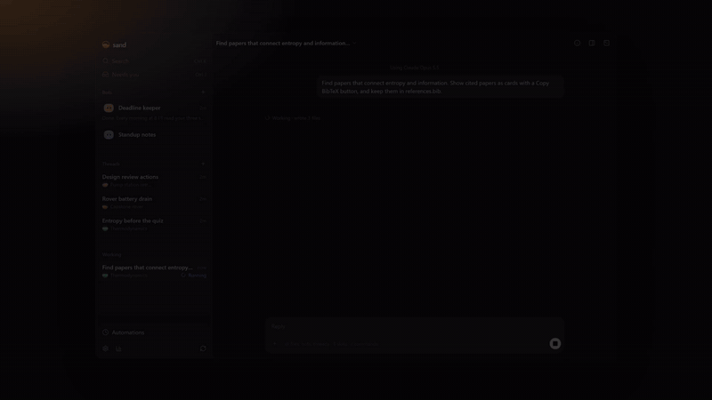
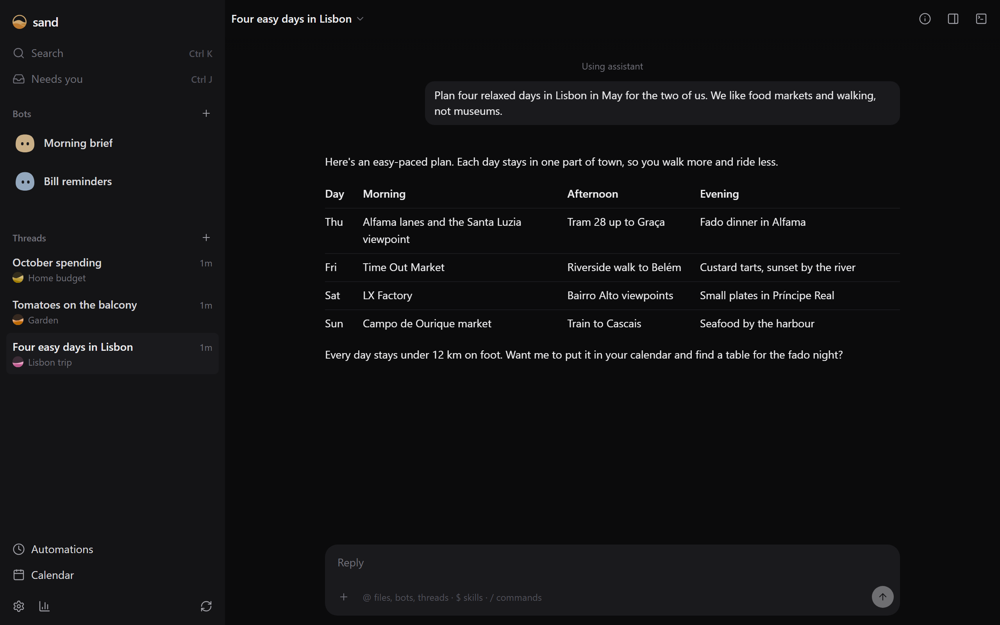
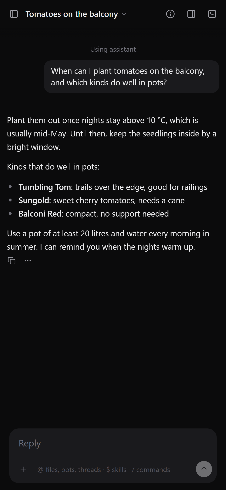
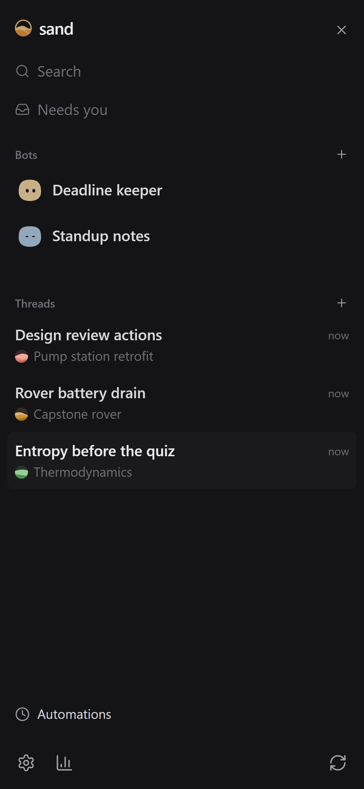

# sand

sand is a chat assistant you can change into whatever you need. Use it like any chat assistant: get ready for an exam, work through a lab report, debug a test rig, turn meeting notes into actions. When you want it to work differently, ask it, and it builds the change into itself. You can use it from your phone too.

[](https://vaakx-dev.github.io/sand/#change)

## Ask it to change itself

Every part of sand is a plugin, so it can add to its own sidebar, side panel, chat or tools, and the change loads without closing your chat. In the clip above, each of these took one request:

- **Citation cards** for a thermodynamics reading list. Papers sand cites show up as cards with the abstract and a Copy BibTeX button, and go into `references.bib`.
- **A PDF reader** for a capstone project. It opens a battery datasheet beside the chat, and page links jump to the right line.
- **A git graph** for a team repo, with every commit and branch in the side panel.

Settings → Add-ons lists the parts sand comes with. Turn them on or off there, or install more.



## Use it anywhere

<p>
  
  
</p>

- **Threads** are chats for anything: coursework, lab reports, work projects. Put related ones in a project, a folder with the files they work on.
- **Bots** take care of ongoing jobs, like reminding you before deadlines or drafting your daily standup, on a schedule or when something changes.
- **Your phone and other PCs.** Chats keep going when you close the tab. Pair your phone or another PC to pick up the same chats there.
- **Your models.** Use a Claude plan through Claude Code, a ChatGPT plan through Codex, or API keys.

## Install

On macOS or Linux, in a terminal:

```sh
curl -fsSL https://vaakx-dev.github.io/sand/install.sh | sh
```

On Windows, in PowerShell:

```powershell
irm https://vaakx-dev.github.io/sand/install.ps1 | iex
```

The installer sets sand up, adds `sand` to your PATH and opens sand in your browser. Then open Settings → Accounts and choose your model. To pair a phone or another PC, open Settings → Devices.

Run `sand` to start sand in the background if it isn't running and open it in your browser. `sand serve` does the same without opening anything and prints a link that opens it paired, for scripts and agents.

sand updates itself from Settings → Updates. On that page you can also switch to the nightly or dev builds.

## Working on sand

sand is built on [drydock](https://github.com/vaakx-dev/drydock) and [VRUI](https://github.com/vaakx-dev/vrui). To run it from a clone, see [docs/development.md](docs/development.md).

sand is MIT licensed.
