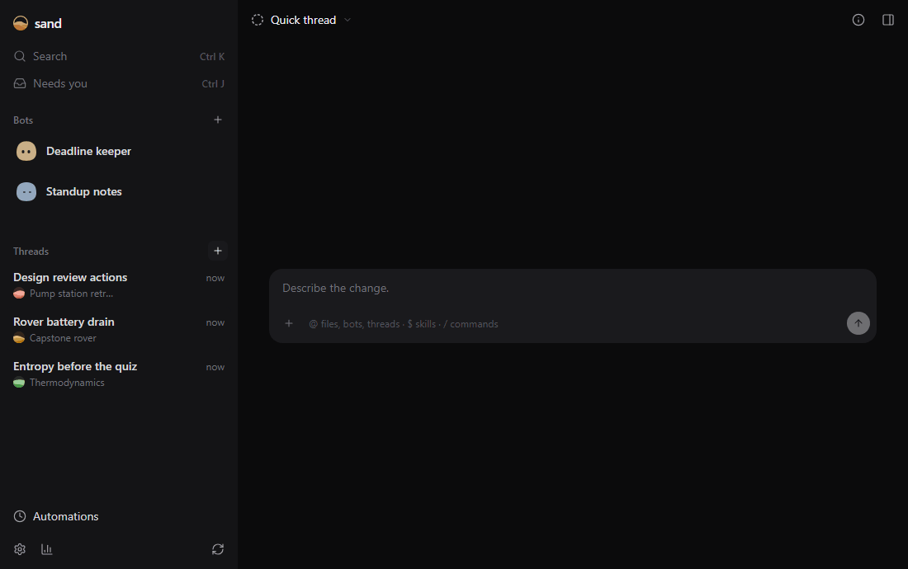

# sand

sand is an assistant you can change into whatever you need. Talk to it like any chat assistant: get ready for an exam, work through a lab report, debug a test rig, turn meeting notes into actions. When you want it to work differently, ask it. Every part of sand is a plugin, so it can change its own sidebar, tools or look and reload the change without closing your chat. You can use it from your phone too.


## Ask it to change itself

Here sand is asked for a focus timer. It writes a small plugin and reloads it, a working timer appears, and the chat stays open.



## Use it anywhere

<p>
  
  
</p>

- **Threads** are chats for anything: coursework, lab reports, work projects. Put related ones in a project, a folder with the files they work on.
- **Bots** take care of an ongoing job, like reminding you before deadlines or drafting your daily standup, on a schedule or when something changes.
- **Your phone and other PCs.** Chats keep going when you close the tab. Pair your phone to pick them up there, and pair other PCs to run threads on them.
- **Your models.** Use a Claude plan through the Claude Code app, a ChatGPT plan through the Codex app, or API keys.

## Install

On macOS or Linux, in a terminal:

```sh
curl -fsSL https://vaakx-dev.github.io/sand/install.sh | sh
```

On Windows, in PowerShell:

```powershell
irm https://vaakx-dev.github.io/sand/install.ps1 | iex
```

The installer puts Bun and sand in `~/.sand`, adds `sand` to your PATH and opens sand in your browser. Then open Settings → Accounts and choose how sand reaches a model. To pair a phone or another PC, open Settings → Devices.

sand updates itself from Settings → Updates. On that page you can also switch to the nightly or dev builds.

## Working on sand

sand is built on [drydock](https://github.com/vaakx-dev/drydock) and [VRUI](https://github.com/vaakx-dev/vrui). To run it from a clone, see [docs/development.md](docs/development.md).

sand is MIT licensed.
