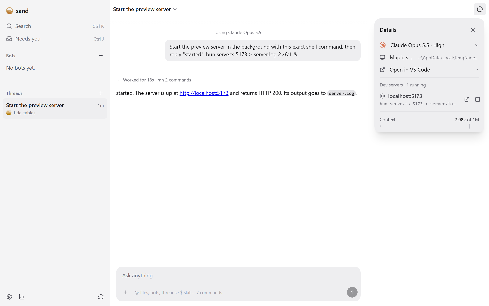

Dev servers lists the web servers each thread started in its Details, with Open and Stop. It finds them through the processes the thread owns, so a server started with `npm run dev &` in a normal command, or as a background command, shows until it stops, even after the turn ends.

## Good for

- Opening the app an agent just started without hunting for its port, on the PC or from your phone, with hot reload
- Stopping servers a thread left running
- Letting agents and scripts list, open and stop them too, with the `dev_server_list`, `dev_server_open` and `dev_server_stop` tools and `sand servers`

## Try it

Ask a thread to start a dev server, such as `npm run dev`, then open its Details.
