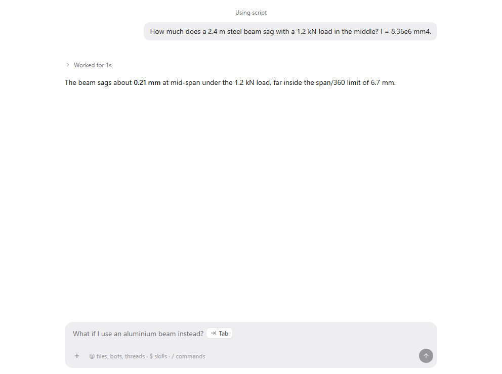

Message guesses offer a likely next message in the empty composer after each reply. Press Tab to take it, or just start typing your own.

## Good for

- Keeping a line of questions going without retyping context
- Quick follow-ups like "what if I use aluminium instead?"
- Long study sessions where the next step is usually obvious

## Try it

Ask anything, wait for the reply, and look at the composer.
