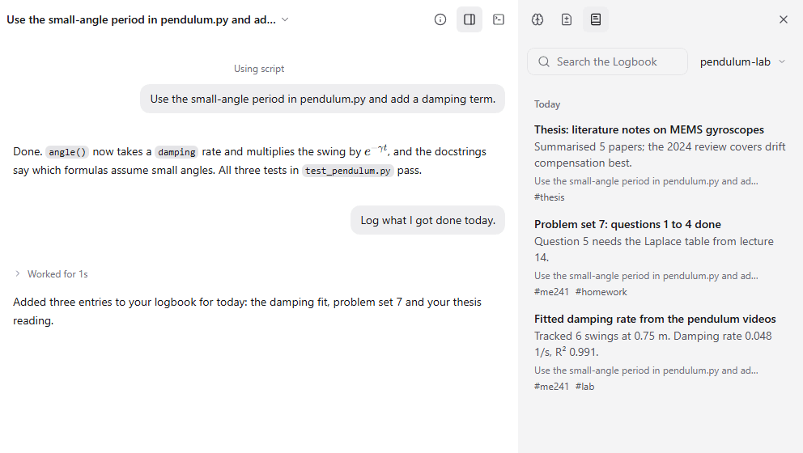

Logbook is a dated record of finished work that threads and bots add to and search. Each entry has a title, a few details with the numbers that matter, tags and a link back to the thread, so the week's progress is easy to find when you write a report or meet your supervisor.

## Good for

- A lab notebook that fills itself in as agents finish tasks
- Weekly progress notes for a thesis or a group project
- Finding the day you measured that damping rate

## Try it

Ask a thread: "Log what I got done today." Then open the side panel and its logbook tab.
