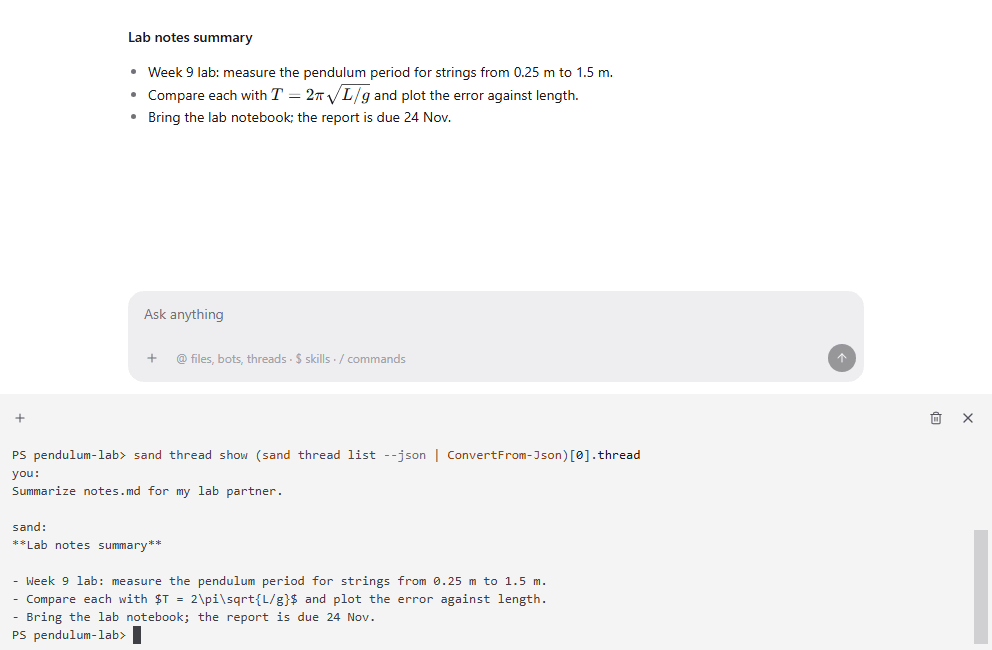

Outside access lets agents and scripts outside sand use it. Other agents connect over MCP after you pair them in Settings, Devices, and scripts start, follow and read threads with `sand thread`.

## Good for

- Starting a thread from a Makefile, a cron job or a CI step
- Letting another coding agent ask sand's threads and bots for help
- Collecting replies into a report with a few lines of shell

## Try it

Run `sand thread start . "Summarize notes.md for my lab partner." --wait` in a project folder.
