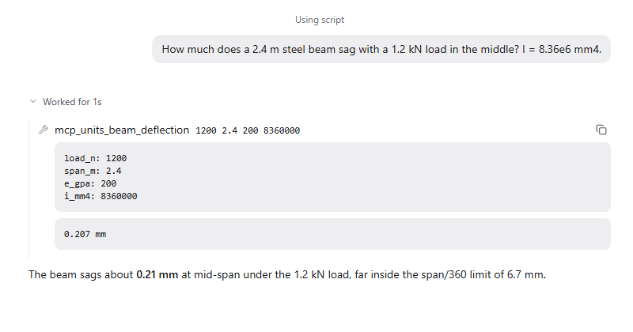

Your MCP servers give agents the tools from any Model Context Protocol server you run: a unit converter, a lab database, a CAD exporter, a company search. Add a server in sand.toml and its tools show up as a group on the Tools page.

## Good for

- Exact calculations from your own code instead of the model's mental math
- Reading data from instruments, databases or internal services
- Reusing tools you already wrote for other agents

## Try it

Add a server under `[plugins.mcp.servers.units]` in sand.toml with its `command` and `args`, then ask: "How much does a 2.4 m steel beam sag with a 1.2 kN load in the middle?"
