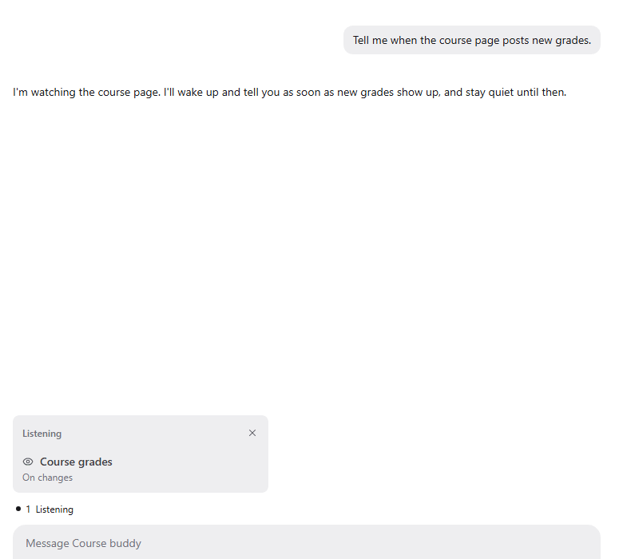

Watches let a bot follow a web page, a folder, a webhook or a repository and wake only when something changes. A cheap watcher does the looking, so the bot costs nothing while nothing happens.

## Good for

- Hearing about new grades or announcements on a course page
- Reacting when a simulation drops its results into a folder
- Following pull requests and CI on a repository you care about

## Try it

Ask a bot: "Tell me when the course page posts new grades."
