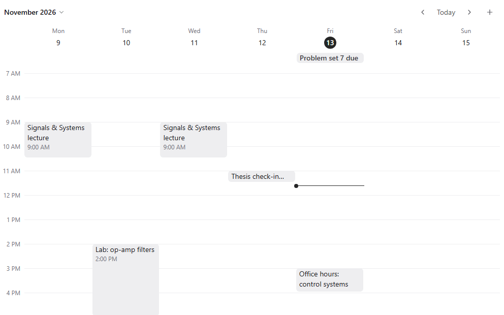

Calendar puts your calendars in one place, in a week or agenda view, and lets your agents read and plan with them. Ask a bot to block time for a lab, find a free hour for a study group, or tell you what is due this week.

## Good for

- Seeing lectures, labs, office hours and deadlines together
- Letting an agent put a whole syllabus on the calendar
- Finding a slot that suits everyone in a project group

## Try it

Ask a thread: "Put my week on the calendar: Signals lecture Monday and Wednesday at 9, the op-amp lab Tuesday 2 to 5, and problem set 7 due Friday."
