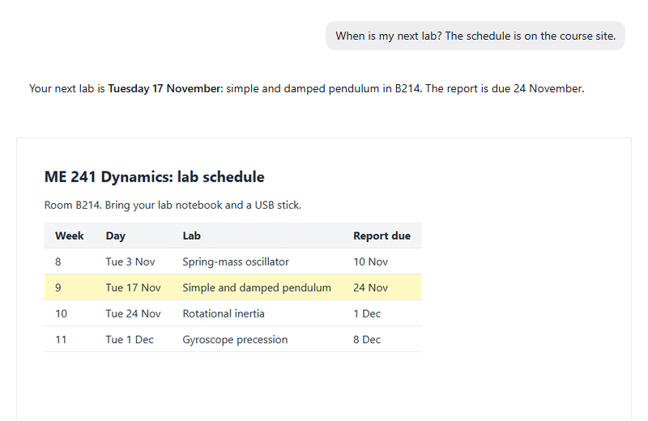

Computer use lets a bot see and use a browser of its own, or this PC's screen, when a page has no API. It opens pages, clicks, types and reads what is on the screen, and it can sign in with your saved logins.

## Good for

- Reading timetables, grades or lab slots from course sites
- Filling in the same web form for every run of an experiment
- Checking a web app you are building the way a user would

## Try it

Open a bot's profile, pick its own browser under Computer, and ask: "When is my next lab? The schedule is on the course site."
