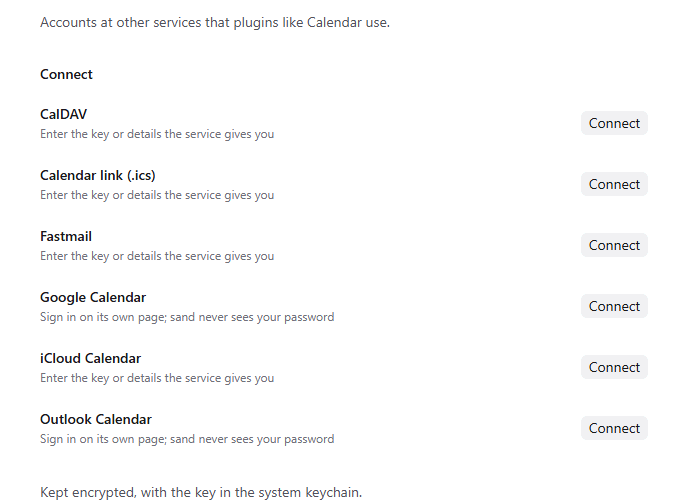

Connected accounts link sand to services like Google, Microsoft, iCloud, Fastmail or any CalDAV server. Other add-ons, like Calendar, use these accounts, so you sign in once and every part of sand that needs the account can use it.

## Good for

- Showing your university Outlook calendar and your personal Google calendar side by side
- Subscribing to a course timetable published as an .ics link
- Signing in on the service's own page, so sand never sees your password

## Try it

Open Settings, Connections, and connect the calendar service you use. Install Calendar to see it.
