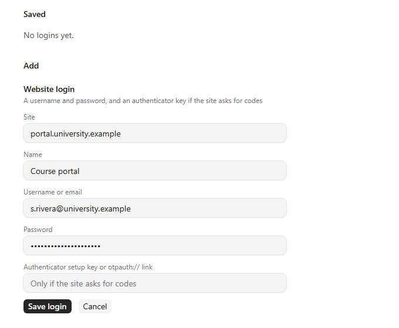

Saved logins let agents sign in to sites and use API keys without ever seeing them. You save a username and password, an authenticator key or a token once; sand fills it in for the agent and keeps it encrypted, with the key in your system keychain. Bitwarden and 1Password work too.

## Good for

- Letting an agent download your grades or lab slots from a course portal
- Giving scripts an API key for a lab instrument or a cloud service
- Two-step sign-ins, with codes from an authenticator key you saved

## Try it

Open Settings, Logins, and add a website login. Then ask an agent to sign in to that site.
