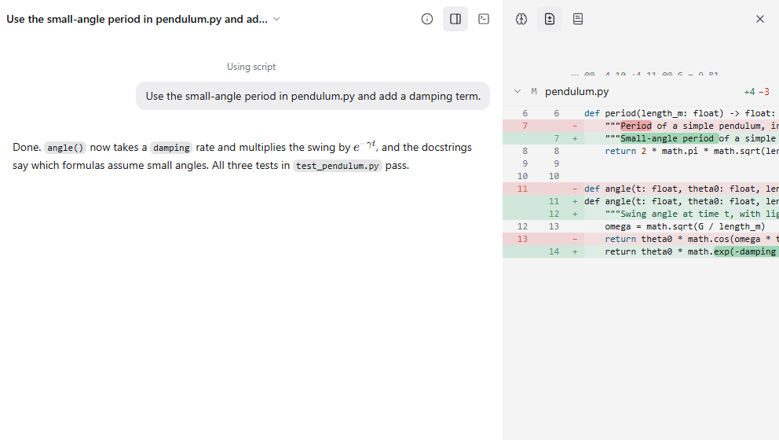

Coding shows what an agent changed in a project folder that is a git repository: the files, the diffs line by line, and the branch with its commits ahead and behind. Each thread can work in its own worktree and branch, and you merge its work back when you are happy with it.

## Good for

- Letting an agent fix a bug or add a feature while you review every line
- Trying two approaches in two threads without them stepping on each other
- Committing, pushing and opening a pull request from the thread

## Try it

Open a thread in a git project and ask: "Add a damping term to the pendulum model and make the tests pass." Then open the side panel to see the diff.
