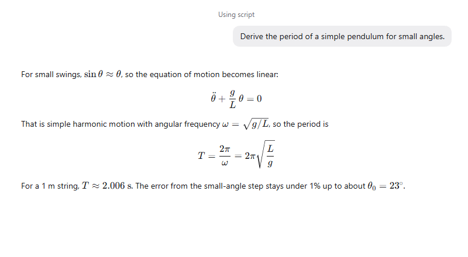

Math turns the LaTeX in replies into real formulas, so a derivation reads like your textbook instead of a wall of backslashes. Inline symbols sit in the sentence; display equations get their own line.

## Good for

- Checking a proof or a derivation step by step
- Units, matrices and aligned equations in lab and design notes
- Asking an agent to explain a formula from a paper

## Try it

Ask: "Derive the period of a simple pendulum for small angles and show each step."
