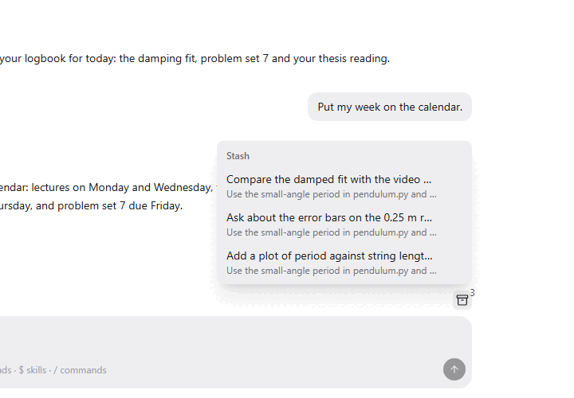

Stash keeps messages you want to send later. Write the thought down, press Ctrl+S, and it waits above the composer until the agent is free or you are ready. The stash follows you to your other devices.

## Good for

- Ideas that come up while an agent is busy with something else
- A to-do list of questions for your lab partner or supervisor
- Moving a half-written message from your laptop to your phone

## Try it

Type a message, press Ctrl+S instead of Enter, then open the stash with the box icon above the composer.
