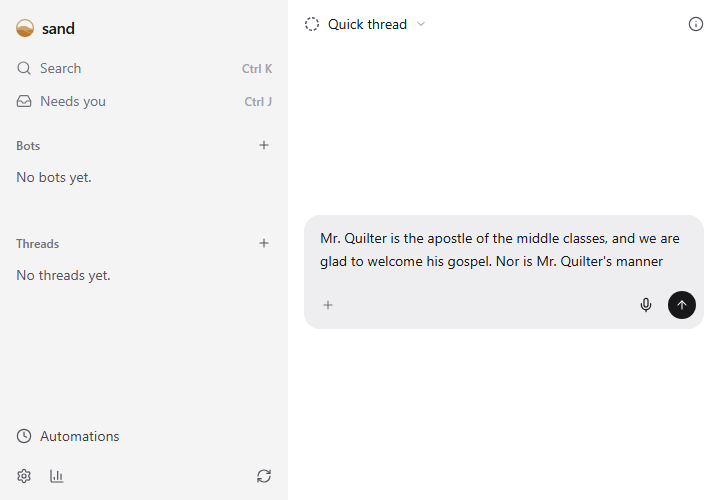

Voice lets you speak instead of typing. Tap the microphone in the message box, say what you want, and tap it again: your words land in the draft, ready to edit and send. Nothing is sent until you send it.

## Good for

- Long explanations that are quicker to say than to type
- Writing from your phone while you walk between lectures
- Notes to a bot while your hands are busy

## Try it

Open Settings › Voice and choose This PC. sand downloads Parakeet, a free English speech model, once (about 700 MB) and checks it. From then on your speech becomes text on your own PC, on its graphics card when it has one, and your audio never leaves it. If you saved an OpenAI API key in Settings › Accounts, you can choose A cloud service instead. Voice uses that key and its address, so a key for Groq or another OpenAI-style service works too.

## On a phone

Browsers only allow the microphone on a secure address. Open sand over HTTPS, such as Tailscale HTTPS from the Devices page. Your phone records, and the PC it's connected to turns the speech into text.
