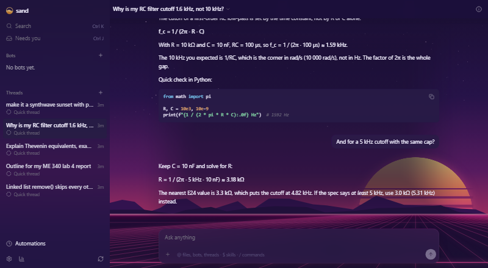

Themes restyles all of sand at once, on every PC and phone you use it on. Pick a base colour and an accent and sand makes every other colour from them, for light and dark. Add an animated background behind frosted panels, calm in the middle where you read and moving at the edges, or write your own CSS.

## Good for

- A calm Blueprint grid behind a late-night circuits problem set
- Telling your work PC from your lab PC at a glance, then matching your phone
- Bigger text, rounder boxes or a quieter sidebar with a few lines of custom CSS

## Try it

Open Settings › Theme and pick Blueprint, Riso, Night shift or Synthwave sunset. Or ask any bot: "make it a synthwave sunset with pink accents". It checks the result on a phone and a desktop screenshot, then shows it with Keep and Undo; it goes back by itself after 30 seconds unless you keep it.

## If a theme hides the page

Open sand with `?theme=off` at the end of its address, or run `sand theme reset`. Both bring back sand's own look on every device.
