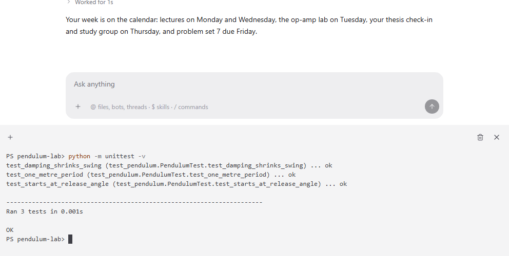

Terminal puts a live shell along the bottom of a chat, already in the thread's folder and on the thread's PC. Run the tests, start a dev server or poke at a file while the agent works, without switching windows.

## Good for

- Running tests and scripts the agent just changed
- Watching a long build or simulation next to the conversation
- Quick checks with git, Python or your own tools

## Try it

Open a thread, press the terminal button in its header and run `python -m unittest -v`.
